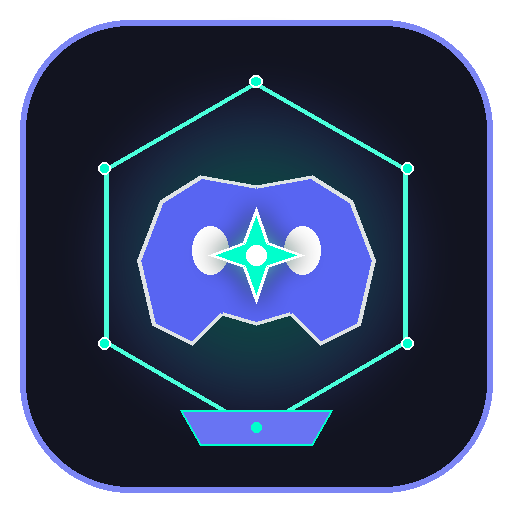

# 🚀 Discord Quest Auto

<p align="center">
  
</p>

<p align="center">
  <b>ระบบช่วยทำเควสต์ Discord แบบอัตโนมัติ รวดเร็ว ปลอดภัย 100% ภายในเครื่อง Localhost</b><br>
  มาพร้อม UI สไตล์ Cyberpunk / ReactBits, ตัวคำนวณ Orbs, ระบบสลับบัญชี และระบบอัปเดตอัตโนมัติจาก GitHub
</p>

---

## ✨ ไฮไลท์ฟีเจอร์เด่น (Key Features)

- **🔑 ดึง Token อัตโนมัติ (1-Click Local Token Extraction)**:
  - สแกนและถอดรหัส Master Key (DPAPI / AES-256-GCM) จาก Discord Desktop, Discord Canary, Discord PTB และ Chromium Browsers ในเครื่องได้ทันที
  - ไม่จำเป็นต้อง Inspect Element หา Token เอง
- **🛡️ Safe Mode ปลอดภัยสูงสุด (Anti-Ban & Anti-Captcha)**:
  - ทำงานในเครื่องคุณเอง 100% (`127.0.0.1`) ไม่มีการส่ง Token ออกนอกเครื่อง
  - **ไม่มีการเคลมของรางวัลอัตโนมัติ (No AutoClaim)** ให้ผู้ใช้เข้าไปกดเคลมใน Discord เอง เพื่อป้องกันการติด Captcha หรือโดนระงับบัญชี
- **⚡ รองรับเควสต์ดูวิดีโอ (Video Watch Quests)**:
  - จำลองความคืบหน้าการดูวิดีโอแบบเร่งสปีดอัจฉริยะ จบเควสต์ได้ในไม่กี่วินาที
  - แสดงหลอด Progress Bar แบบเรียลไทม์ พร้อมตัวเลขนับเวลาถอยหลัง
- **🔄 Live Sync ทุก 5 วินาที พร้อม Rate-Limit Shield**:
  - รีเฟรชสถานะเควสต์อัตโนมัติทุกๆ 5 วินาที
  - มีระบบ Shield ดักจับ Discord Rate Limit (429) และสลับใช้ข้อมูลแคชโดยไม่ทำให้แอปค้าง
- **🔮 ตัวคำนวณ Discord Orbs รวม (Real-time Orbs Calculator)**:
  - คำนวณแต้ม Discord Orbs ทั้งหมดที่ได้รับ
  - แยกแสดง Orbs ที่พร้อมเคลมทันที และ Orbs ที่รอทำต่อ
- **👥 ระบบประวัติบัญชี & สลับไอดี (Account History & Switcher)**:
  - บันทึกโปรไฟล์ Discord (Avatar, Username, ID)
  - สลับบัญชีที่ต้องการได้ใน 1 คลิก โดยไม่ต้องกรอก Token ซ้ำ
- **🚀 ระบบตรวจสอบอัปเดตอัตโนมัติ (GitHub Auto Updater)**:
  - เช็คเวอร์ชันใหม่จาก Repository `https://github.com/Newwee/discordquest`
  - มี Notification Badge แจ้งเตือนเมื่อมีเวอร์ชันใหม่ พร้อมแสดง Changelog
- **🎨 UI ตอบสนองทุกขนาดหน้าจอ (Fluid Responsive UI)**:
  - เอฟเฟกต์ Aurora Blob, Cyber Dot Mesh Grid, Spotlight Tracking Cards และ Border Beam จาก ReactBits
  - รองรับอัตราส่วนหน้าจอทุกรูปแบบ: 16:9, 4:3, 1:1, สปลิทหน้าต่าง และ Mobile

---

## 📥 วิธีติดตั้งและเริ่มต้นใช้งาน (Installation)

### วิธีที่ 1: ติดตั้งผ่าน Windows Installer (ง่ายที่สุด)
1. ดาวน์โหลดไฟล์ `DiscordQuestAuto_Setup.zip` หรือ `Setup.exe`
2. ดับเบิลคลิกเปิด `Setup.exe`
3. กดยอมรับข้อตกลงและเงื่อนไข (Accept Terms) แล้วกด **"ติดตั้งทันที"**
4. เปิดใช้งานผ่าน Shortcut บน Desktop หรือ Start Menu

### วิธีที่ 2: รันผ่าน Source Code (Node.js)
1. ตรวจสอบว่าในเครื่องมี **Node.js** (v18+) ติดตั้งอยู่
2. โคลน Repository นี้:
   ```bash
   git clone https://github.com/Newwee/discordquest.git
   cd discordquest
   ```
3. รันโปรแกรม:
   ```bash
   node server.js
   ```
   หรือดับเบิลคลิกที่ `launch.vbs` เพื่อรันแบบเงียบๆ ในพื้นหลัง
4. เปิดเบราว์เซอร์ไปที่: `http://localhost:4545`

---

## 🛠️ โครงสร้างโปรเจกต์ (Project Structure)

```
DiscordQuestAuto/
├── server.js              # Local HTTP & SSE Server (Zero-dependency)
├── token_extractor.js     # ตัวถอดรหัส Local Discord DPAPI Token
├── version.json           # ข้อมูลเวอร์ชันและ Release Notes ล่าสุด
├── config.json            # ไฟล์บันทึกการตั้งค่าและประวัติบัญชี (Local Only)
├── launch.vbs             # Silent background launcher
├── Setup.cs               # C# Installer Source Code
├── Setup.exe              # Standalone Windows GUI Installer
├── push_to_github.bat     # สคริปต์ Push อัปเดตขึ้น GitHub ในคลิกเดียว
└── public/
    ├── index.html         # Web Application UI
    ├── style.css          # ReactBits & Cyberpunk Theme
    ├── app.js             # Logic ฝั่ง Client, อัปเดต, บัญชี, เควสต์
    ├── logo.png           # โลโก้ความละเอียดสูง
    └── favicon.ico        # Favicon ไอคอนเว็บ
```

---

## 🔒 ความปลอดภัยและความเป็นส่วนตัว (Privacy & Security)

- **Localhost 100%**: ทุกการประมวลผลและการบันทึกข้อมูล Token อยู่ในเครื่องคอมพิวเตอร์ของคุณเท่านั้น
- **No Remote Token Exfiltration**: โค้ดทั้งหมดเปิดเผย (Open-source) สามารถตรวจสอบได้ว่าไม่มีการยิง Token ไปยังเซิร์ฟเวอร์ภายนอกใดๆ ทั้งสิ้น
- **Protected .gitignore**: ไฟล์ `config.json` ถูกตั้งค่าไม่ให้ push ขึ้น GitHub โดยเด็ดขาด

---

## 👨‍💻 พัฒนาโดย

- **Repository**: [https://github.com/Newwee/discordquest](https://github.com/Newwee/discordquest)
- **Engine**: Node.js & Vanilla JavaScript (Zero External Dependencies)
